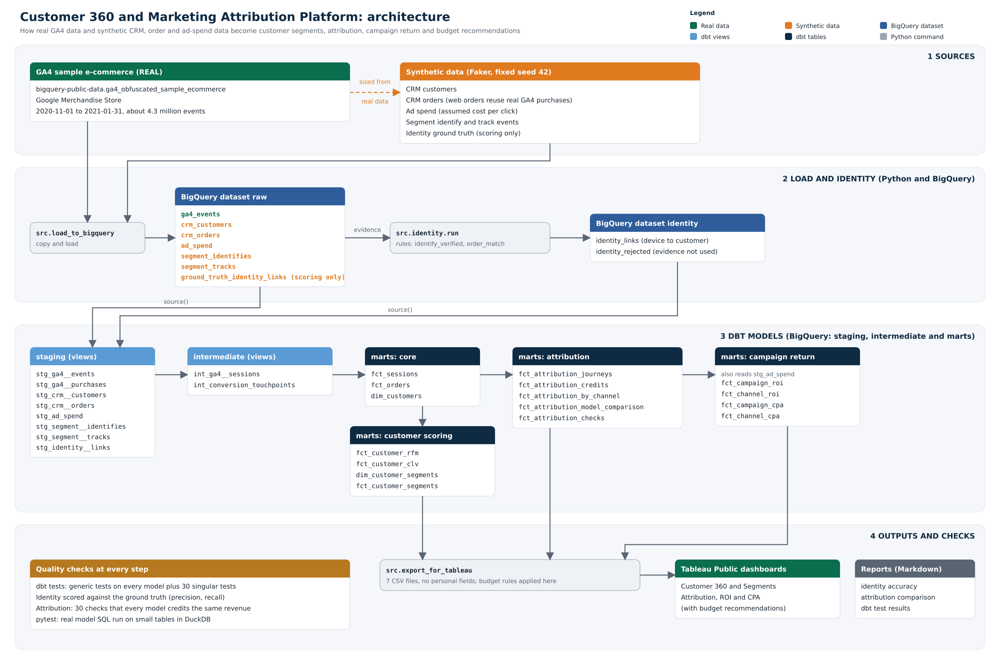

# Customer 360 and Marketing Attribution Platform

One customer view built from website, CRM and ad-spend data, and an answer to the question every marketing team asks: **which channels actually bring revenue, and where should the budget move?**

Internship project DA-02 (Data Analytics track). Built with BigQuery, dbt, Python and Tableau.

> ## Which data is real and which is synthetic
>
> | Data | Real or synthetic | Details |
> |---|---|---|
> | **Website sessions, events and purchases (GA4)** | **Real** | Google's public GA4 sample e-commerce dataset (`bigquery-public-data.ga4_obfuscated_sample_ecommerce`): the Google Merchandise Store, 2020-11-01 to 2021-01-31, about 4.3 million events. |
> | **CRM customers and orders** | **Synthetic** | Generated with Faker and a fixed seed (42). Built on real GA4 users and purchases so each synthetic row lines up with a real one: CRM web orders reuse the real GA4 purchase time and revenue. Names, emails, phones, refunds and app orders are made up. |
> | **Ad spend** | **Synthetic** | Sized from the real daily sessions of each paid campaign, with *assumed* costs per click. The method is real; the dollar amounts are not a real advertiser's results. |
> | **Segment events and the identity ground truth** | **Synthetic** | Segment is not used as a live service. The events follow Segment's `identify` and `track` format. The ground truth is used only to score identity resolution, never by the models. |
>
> So every ROAS, ROI and cost-per-acquisition figure in this project shows *how to measure* marketing return, not what any real company earned. Details and every assumption: [docs/synthetic_data.md](docs/synthetic_data.md).

## What it does

1. **Loads** the real GA4 sample and the synthetic CRM, orders, ad spend and Segment-style events into BigQuery.
2. **Resolves identity**: links anonymous website devices to CRM customers with explainable rules, and scores them against the ground truth.
3. **Models** sessions, orders and customers in dbt, with 30 singular tests plus generic tests on every model.
4. **Scores customers**: RFM scores, customer lifetime value and nine segments, each with a recommended action.
5. **Compares four attribution models** (first touch, last touch, linear, time decay) and checks that each one credits exactly the revenue that exists.
6. **Measures campaign return**: ROAS, ROI, cost per order and cost per new customer, and turns them into budget recommendations.
7. **Presents** the findings in two Tableau Public dashboards.

## Headline results

| Area | Result |
|---|---|
| Customers | 6,003 CRM customers, 3,763 of them buyers (62.7%); 5,120 orders; $344,692 net revenue after refunds |
| Repeat buying | 24.9% of buyers ordered more than once; 75% ordered once, so the second order is the growth lever |
| Identity resolution | Precision 100.0% (5,931 of 5,931 links) and recall 90.8% (5,931 of 6,529 true links), which is the best possible for these rules: the remaining 598 links have no usable signal. 85.3% of purchase revenue sits on a linked device. Scored on synthetic ground truth, so precision shows the rules are sound, not that real data would be this clean. [Report](reports/identity_accuracy_report.md) |
| Attribution checks | 30 of 30 checks pass: every model credits all 5,120 orders and exactly $344,692, with a $0 difference between models. [Report](reports/attribution_comparison.md) |
| Attribution finding | The rule barely changes the picture here: Organic Search is about 43% and Referral about 25% of revenue under all four models. Paid Search is the only channel that clearly introduces customers (+$355 under first touch versus last touch). |
| Campaign return | Paid Search takes 96% of the $8,386 paid spend (Email excluded, see below) and returns $0.37 to $0.82 of revenue per $1 under every view. |
| Budget recommendation | Cut Paid Search spend 30% as a test ($8,047 to $5,633), hold Email, and do not judge Affiliate or Display yet (too few orders). No channel earns an increase. Rules: [docs/budget_recommendations.md](docs/budget_recommendations.md) |

## Dashboards (Tableau Public)

Two dashboards present the results: **Customer 360 and Segments** (who the customers are, which segments matter and what to do with each) and **Attribution, ROI and CPA** (which channels get the credit, what they return and cost, and where the budget should move).

Screenshots, live links, what each dashboard shows and how to read it: **[tableau/README.md](tableau/README.md)**.

## How the data flows



*Green is real data, orange is synthetic. Editable vector version: [architecture.svg](docs/architecture/architecture.svg); how it is built: [docs/architecture/README.md](docs/architecture/README.md).*

Layers: `raw` (loaded as is), `staging` and `intermediate` (views), `marts` (tables). Every table and column is described in [docs/data_dictionary.md](docs/data_dictionary.md), and every measure in [docs/metric_dictionary.md](docs/metric_dictionary.md).

## Setup

You need:

- Python 3.12 (uv installs it for you) and [uv](https://docs.astral.sh/uv/)
- the [Google Cloud CLI](https://cloud.google.com/sdk/docs/install)
- a Google Cloud project with BigQuery. The free **sandbox** is enough, no billing needed. The GA4 copy reads about 3 GB, a small part of the 1 TB monthly free allowance.
- [Tableau Public Desktop](https://www.tableau.com/products/public/download) (free), only to open or rebuild the dashboards

### 1. Install and sign in

```bash
git clone https://github.com/MayankAgrawal099/Customer_360_and_Marketing_Platform.git
cd Customer_360_and_Marketing_Platform
uv sync
gcloud auth application-default login
gcloud config set project YOUR_PROJECT_ID
```

The code defaults to the project `da02-customer360`. If yours is different, set it once for the session:

```bash
export GCP_PROJECT=YOUR_PROJECT_ID      # Windows Command Prompt: set GCP_PROJECT=YOUR_PROJECT_ID
```

Check that dbt can reach BigQuery:

```bash
uv run dbt debug --project-dir dbt --profiles-dir dbt
```

No keys or passwords are stored anywhere: dbt and the Python scripts use the login from `gcloud auth application-default login`.

### 2. Build the data, in this order

The synthetic CSVs are already committed in `data/synthetic/`, so you can skip step 2a unless you want to regenerate them.

| Step | Command | What it does |
|---|---|---|
| 2a (optional) | `uv run python -m src.synthetic.ga4_extract` then `uv run python -m src.synthetic.generate_crm` | Downloads three small facts files from the GA4 sample, then regenerates the synthetic CRM, orders, ad spend and Segment events. Same seed, same output. |
| 2b | `uv run python -m src.load_to_bigquery` | Creates the `raw` dataset: a copy of the GA4 sample plus the synthetic tables, then checks row counts and that every shared key exists on both sides. Add `--dry-run` first to see what it would read. |
| 2c | `uv run python -m src.identity.run` | Resolves identity, writes the `identity` dataset and `reports/identity_resolution_report.md`. |
| 2d | `uv run dbt run --project-dir dbt --profiles-dir dbt` | Builds staging, intermediate and marts. |
| 2e | `uv run dbt test --project-dir dbt --profiles-dir dbt` | Runs every dbt test. All must pass. |

Every step is safe to re-run: tables are replaced, not appended.

> **BigQuery sandbox note:** sandbox tables expire after 60 days. If a table has disappeared, re-run steps 2b to 2d; it rebuilds everything in a few minutes.

### 3. Reports and test records

```bash
uv run python -m src.identity.accuracy        # precision, recall and stress test -> reports/identity_accuracy_report.md
uv run python -m src.attribution_report       # four models compared -> reports/attribution_comparison.md
uv run python -m src.dbt_results --run        # runs dbt test and records it -> docs/dbt_test_results.md
```

### 4. Tableau

The packaged workbooks in `tableau/workbooks/` already contain their data: open them in Tableau Public Desktop, no export needed. To refresh the data from BigQuery:

```bash
uv run python -m src.export_for_tableau        # writes seven CSVs into tableau/data/ (git-ignored)
```

### 5. Python tests

```bash
uv run pytest -q
```

The test suite needs no Google login. It runs the real model SQL on small hand-built tables in DuckDB, checks the Python rules, and checks that documents, extracts and models stay in step.

## Repository structure

```
Customer_360_and_Marketing_Platform/
├── dbt/          # dbt project: staging, intermediate and mart models, macros, 30 singular tests
├── src/          # Python: synthetic data, BigQuery load, identity resolution, reports, Tableau export
├── sql/          # standalone SQL: GA4 exploration, GA4 extracts, checks, Tableau extracts
├── data/         # committed synthetic data files and identity link files (raw downloads are git-ignored)
├── tableau/      # packaged workbooks and the dashboard notes
├── docs/         # data and metric dictionaries, method notes, screenshots
├── reports/      # identity and attribution reports
├── tests/        # pytest suite
├── pyproject.toml, uv.lock, .python-version
└── README.md
```

## Documentation

| Document | What it covers |
|---|---|
| [docs/data_api_docs.md](docs/data_api_docs.md) | Reference for every dataset, dbt model, output file and command (generated) |
| [docs/data_dictionary.md](docs/data_dictionary.md) | Every table and column, raw to marts |
| [docs/metric_dictionary.md](docs/metric_dictionary.md) | RFM, CLV, attribution, ROI and CPA definitions |
| [docs/synthetic_data.md](docs/synthetic_data.md) | How the synthetic data is built, every assumption, rules for using it honestly |
| [docs/identity_resolution.md](docs/identity_resolution.md) | Matching rules, conflicts, what is deliberately not done |
| [docs/customer_segments.md](docs/customer_segments.md) | The nine segments and their rules |
| [docs/attribution.md](docs/attribution.md) | The four attribution models |
| [docs/campaign_roi.md](docs/campaign_roi.md), [docs/cpa.md](docs/cpa.md) | Return and cost per acquisition |
| [docs/budget_recommendations.md](docs/budget_recommendations.md) | The budget rules and thresholds |
| [docs/test_results.md](docs/test_results.md) | Final results of every check on one page |
| [docs/dbt_test_results.md](docs/dbt_test_results.md) | The recorded result of `dbt test` |
| [docs/ga4_exploration.md](docs/ga4_exploration.md) | What the GA4 sample contains and its quirks |

## Limitations to keep in mind

- **Synthetic CRM and spend.** See the box at the top. Nothing here is a real advertiser's result.
- **Email is left out of ROAS and CPA charts.** Its cost per click is a few cents by assumption, so its ROAS is in the hundreds and is an artifact, not a finding. It appears in the budget table as Hold.
- **No Paid Social spend** exists in the data, so Paid Social has no rows.
- **Campaign detail is thin.** GA4 sample campaign names are obfuscated (`<Other>`), one campaign holds about 99.9% of Paid Search spend, and almost every other campaign has fewer than 5 orders. Budget decisions are made at channel level.
- **ROAS is revenue over spend, not profit.** Product costs are not in the data.
- **Identity precision is measured on clean synthetic data.** The stress test in [reports/identity_accuracy_report.md](reports/identity_accuracy_report.md) shows what happens when evidence is damaged.
- **GA4 covers three months** (2020-11-01 to 2021-01-31), so the customer lifetime value figures are an upper estimate, and "as of" is 1 Feb 2021.
- **Segment is mimicked, not used as a live service.**

## Data source

The real data is Google's public GA4 sample e-commerce dataset (Google Merchandise Store). See [Google's description of the dataset](https://developers.google.com/analytics/bigquery/web-ecommerce-demo-dataset).

---

Author: Mayank Agrawal. Repository: [MayankAgrawal099/Customer_360_and_Marketing_Platform](https://github.com/MayankAgrawal099/Customer_360_and_Marketing_Platform).
