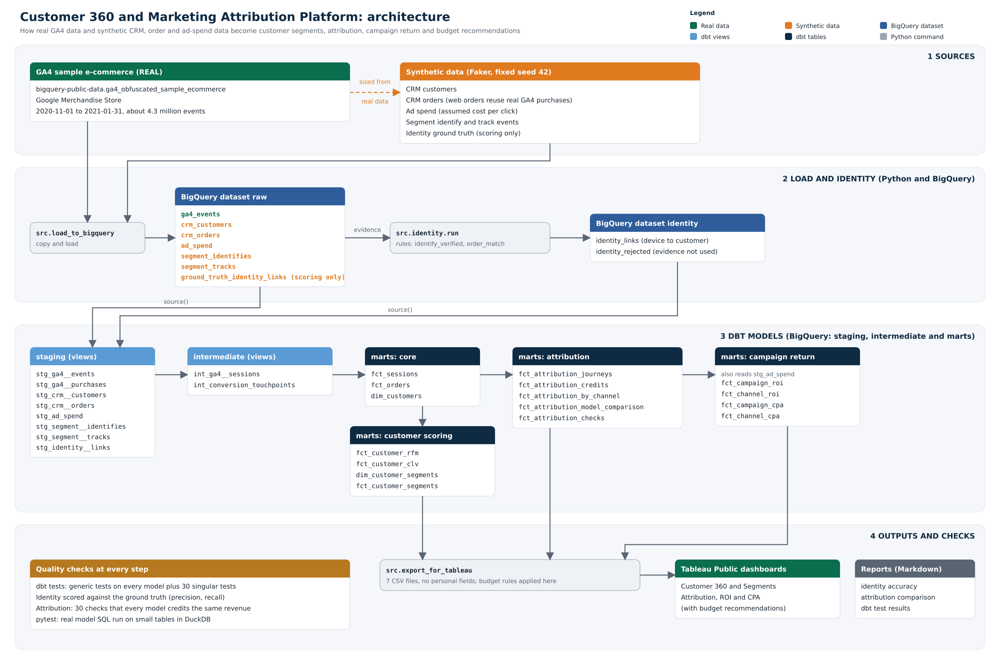

# Architecture



The picture reads top to bottom, in four bands.

| Band | What happens | Where it lives |
|---|---|---|
| 1 Sources | Real GA4 sample events; synthetic CRM, orders, ad spend, Segment events and the identity ground truth. The synthetic data is sized from the real sessions. | `src/synthetic/`, `data/synthetic/` |
| 2 Load and identity | `src.load_to_bigquery` loads everything into the BigQuery `raw` dataset. `src.identity.run` applies two rules (`identify_verified`, `order_match`) and writes `identity_links` and `identity_rejected`. The ground truth is only used to score the rules. | `src/load_to_bigquery.py`, `src/identity/` |
| 3 dbt models | staging (views) → intermediate (views) → marts (tables): core, customer scoring, attribution, campaign return. | `dbt/models/` |
| 4 Outputs and checks | `src.export_for_tableau` writes 7 CSV files (no personal fields, budget rules applied) for the two Tableau Public dashboards. Reports are written as Markdown. Checks run at every step. | `src/export_for_tableau.py`, `docs/`, `dbt/tests/`, `tests/` |

Colours: green is real data, orange is synthetic data, blue is a BigQuery dataset, light blue is a dbt view, dark blue is a dbt table, grey is a Python command.

## Files

- `architecture.png` is the image shown in the root README.
- `architecture.svg` is the vector original (sharp at any size).
- `build_diagram.py` draws both. It uses only the standard library.

## Regenerate

```bash
uv run python docs/architecture/build_diagram.py
```

The SVG is always written. The PNG is refreshed only if `rsvg-convert` is installed (on Windows, edit the SVG and export a PNG with any browser or Inkscape, 2400 px wide).

`tests/test_architecture.py` checks that every model, table, command and count named in the picture exists in the repository, so the picture cannot drift from the code.
