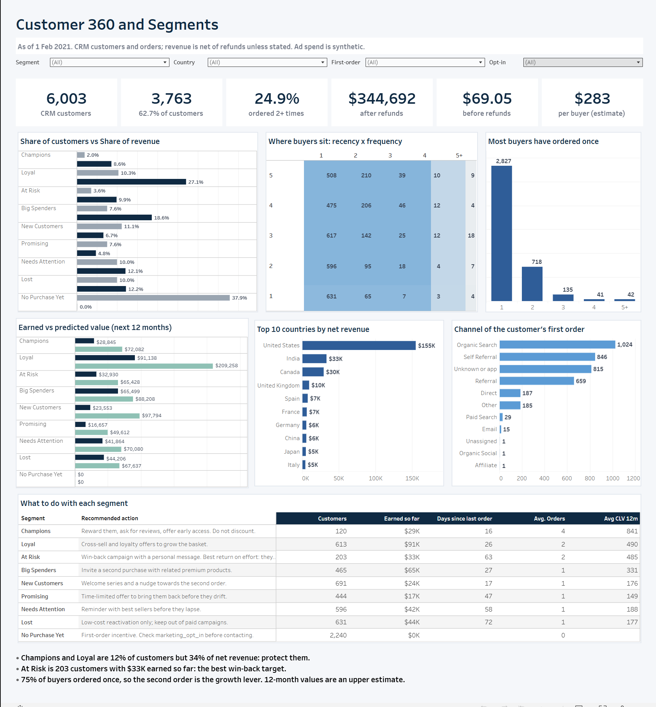
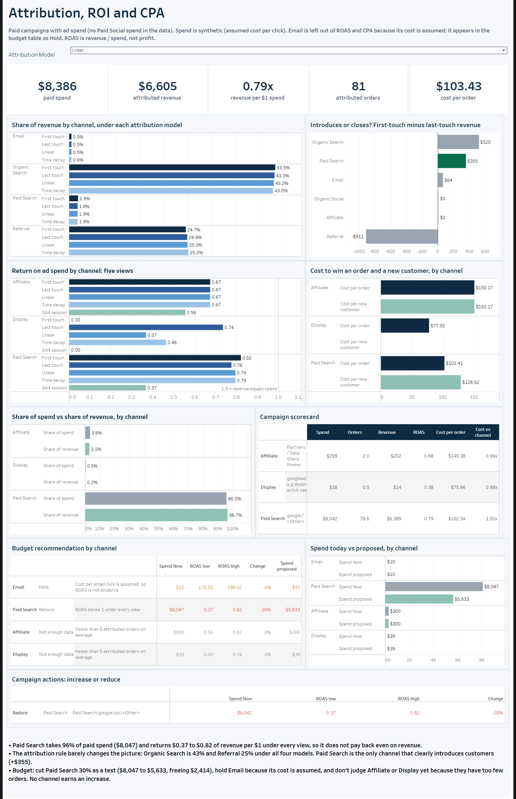

# Tableau dashboards

Two dashboards present the results. Both are published on Tableau Public and saved here as packaged workbooks (`.twbx`, data included), so you can open them without any export.

| Dashboard | Live link | Workbook |
|---|---|---|
| Customer 360 and Segments | [Tableau Public](https://public.tableau.com/app/profile/mayank.agrawal6844/viz/customer_360/Customer360andSegments) | [workbooks/customer_360.twbx](workbooks/customer_360.twbx) |
| Attribution, ROI and CPA | [Tableau Public](https://public.tableau.com/app/profile/mayank.agrawal6844/viz/attribution_roi_cpa/AttributionROIandCPA) | [workbooks/attribution_roi_cpa.twbx](workbooks/attribution_roi_cpa.twbx) |

> The GA4 website data is real; the CRM, orders and ad spend are synthetic. Every dollar figure on both dashboards comes from that mix, and ad spend uses assumed costs per click. The dashboards show the method, not a real advertiser's results. Details: [../docs/synthetic_data.md](../docs/synthetic_data.md).

## 1. Customer 360 and Segments

**Question:** who are our customers, which segments matter, and what should we do with each?



**What is on it**

| Part | Shows |
|---|---|
| Filters | Segment, country, channel of the first order, marketing opt-in |
| Six KPI cards | Customers, buyers, repeat rate, net revenue after refunds, average order value before refunds, average 12-month customer lifetime value per buyer (an estimate) |
| Share of customers vs share of revenue | Which segments earn more than their size |
| Recency x frequency | How many buyers sit at each recency score and order count |
| Orders per buyer | How many buyers ordered once, twice and more |
| Earned vs predicted value | What each segment has paid so far against the 12-month prediction |
| Top 10 countries | Net revenue by country |
| Channel of the first order | Where buyers first came from |
| Segment table | Customers, revenue earned, days since last order, orders, CLV and the recommended action for each of the nine segments |

**What it shows**

- 6,003 customers, of whom 3,763 (62.7%) have bought; net revenue is $344,692 across 5,120 orders, with an average order value of $69.05 before refunds.
- Champions and Loyal are 12% of customers but 34% of net revenue. Protect them.
- At Risk is 203 customers with $33K earned so far: the best win-back target.
- 75% of buyers ordered once (2,827 of 3,763) and 24.9% ordered more than once, so the second order is the growth lever.
- The United States is about 45% of revenue ($155K), then India ($33K) and Canada ($30K).
- 54% of buyers have no usable marketing source for their first order, and only 29 buyers (about 1%) started with Paid Search. Paid media is a small part of how customers arrive.
- Segment sizes: Champions 120, Loyal 613, At Risk 203, Big Spenders 465, New Customers 691, Promising 444, Needs Attention 596, Lost 631, No Purchase Yet 2,240. Rules: [../docs/customer_segments.md](../docs/customer_segments.md).

**Reading it right:** 12-month values are an upper estimate (three months of history only). "As of" is 1 Feb 2021, the end of the GA4 window.

## 2. Attribution, ROI and CPA

**Question:** which channels get the credit, what do they return and cost, and where should the budget move?



**What is on it**

| Part | Shows |
|---|---|
| Attribution model dropdown | Linear (default), first touch, last touch, time decay, or GA4 session. It drives the KPI cards, cost chart, share chart, scorecard |
| Five KPI cards | Paid spend, attributed revenue, ROAS, attributed orders, cost per order |
| Share of revenue by channel | What each of the four attribution models credits to each channel |
| Introduces or closes? | First-touch minus last-touch revenue per channel |
| Return on ad spend, five views | ROAS per channel under the four models and GA4 session, with a line at 1.0 (revenue equals spend) |
| Cost to win an order and a new customer | Cost per order (CPA) and cost per new customer (CAC) per channel |
| Share of spend vs share of revenue | Where the money goes against where the revenue comes from |
| Campaign scorecard | Spend, orders, revenue, ROAS and cost per order for campaigns above $30 of spend |
| Budget recommendation | Per channel: spend now, ROAS range across the five views, recommendation, suggested change, proposed spend |
| Spend today vs proposed, campaign actions | The same decision as a chart, and the campaigns to increase or reduce |

**What it shows**

- Paid spend is $8,386 against $6,605 of attributed revenue under the linear model: ROAS 0.79x and $103.43 per order.
- Paid Search takes 96.0% of paid spend and 96.7% of revenue, and its ROAS is between 0.37 and 0.82 under every view, so it does not pay back even on revenue.
- The attribution rule barely changes the picture: Organic Search is 43% and Referral 25% of revenue under all four models. Paid Search is the only channel that clearly introduces customers (+$355).
- **Recommendation:** cut Paid Search by 30% as a test ($8,047 to $5,633, freeing $2,414), hold Email because its cost is assumed, and do not judge Affiliate or Display yet because they have too few orders. No channel earns an increase.

**How the recommendation is decided** ([../docs/budget_recommendations.md](../docs/budget_recommendations.md)): a channel or campaign is Increase when ROAS is at least 1.5 under every view, Reduce when ROAS is below 1 under every view, Not enough data when it has fewer than 5 attributed orders, and Hold otherwise. Email is always Hold. The suggested change is a rule of thumb for a test, not a forecast.

**Reading it right**

- **GA4 session** is the narrowest view: a purchase counts only for the campaign of its own session. The four attribution models look back over the customer's journey, so they also credit earlier touches.
- **Email is left out of the ROAS and CPA charts.** Its assumed cost per click is a few cents, which makes its ROAS meaningless. It shows in the budget table as Hold.
- There is **no Paid Social spend** in the data.
- ROAS is revenue over spend, not profit. Product costs are not in the data.
- Under GA4 session there is no cost per new customer, because a GA4 purchase has no customer id.

## Data behind the dashboards

Tableau Public Desktop reads CSV files only (it has no BigQuery connector), so a script exports the marts to CSV. Each file comes from one query in [../sql/tableau/](../sql/tableau/) and contains no names, emails or other personal fields (a test checks this).

| File | Rows are | Used by |
|---|---|---|
| `customers.csv` | one CRM customer | Customer 360 |
| `segments.csv` | one segment (definition, rule, action) | Customer 360 |
| `orders.csv` | one CRM order | Customer 360 |
| `attribution_by_channel.csv` | one model x credited channel | Attribution, ROI and CPA |
| `channel_performance.csv` | one model x paid channel | Attribution, ROI and CPA |
| `campaign_performance.csv` | one model x paid campaign | Attribution, ROI and CPA |
| `budget_recommendations.csv` | one channel or campaign | Attribution, ROI and CPA |

To refresh them from BigQuery (repository root, after the dbt build):

```bash
uv run python -m src.export_for_tableau                 # all seven files into tableau/data/ (git-ignored)
uv run python -m src.export_for_tableau --only roi      # only the four marketing files
uv run python -m src.export_for_tableau --only customers
```

Then open the workbook in Tableau Public Desktop and point each data source at the new CSV (on the Data Source page, **Edit Connection**). The attribution dashboard's model dropdown is a workbook parameter, so it needs no data change.

## Folder contents

- `workbooks/`: the two packaged workbooks (`.twbx`).
- `exports/`: reserved for exported dashboard images.
- `data/` (not committed): the exported CSV files.

Tableau Public saves workbooks publicly. That is acceptable here because the data is synthetic and has no personal fields.
